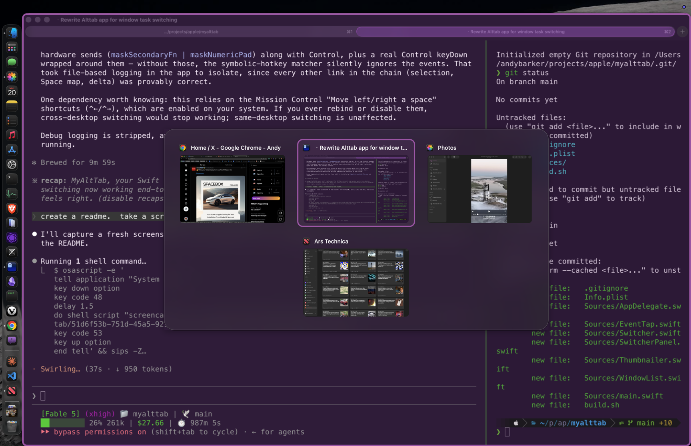

# MyAltTab

A window-level task switcher for macOS, written in Swift. One feature, done well:
hold ⌥, tap Tab, see every window everywhere, release to switch.



## Usage

| Keys | Action |
|---|---|
| ⌥ Tab (hold ⌥) | Open the switcher / cycle forward |
| ⌥ ⇧ Tab | Cycle backward |
| ← / → | Move selection while open |
| release ⌥ | Switch to the selected window |
| Esc | Cancel |

The switcher shows one tile per window — every app, every desktop (Space), minimized and
hidden windows included — ordered most-recently-used first, with live thumbnails and a
full-size preview of the selection drawn at its real position. Selecting a window on
another desktop switches to that desktop.

The menu bar icon has **Settings…** (⌘,):

- **Include Finder windows** — off by default
- **Start at login**

## Build

```sh
./build.sh
ditto build/MyAltTab.app /Applications/MyAltTab.app
open /Applications/MyAltTab.app
```

Plain `swiftc`, no Xcode project. Signs with an Apple Development identity when one is
present (keeps TCC grants stable across rebuilds), ad-hoc otherwise. Requires macOS 14+;
built and tested on macOS 26.

## Permissions

- **Accessibility** — the ⌥Tab event tap and window raising
- **Screen Recording** — window thumbnails (ScreenCaptureKit); without it tiles fall back
  to app icons

Both are prompted on first launch. Accessibility is picked up while running; no relaunch
needed.

Cross-desktop switching uses the Mission Control "Move left/right a space" shortcuts
(^← / ^→), so those must stay enabled in System Settings → Keyboard → Shortcuts.
